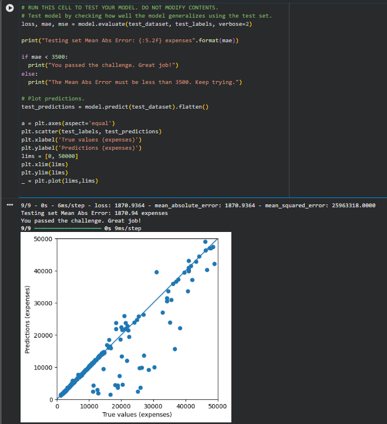

# Predict Health Costs with Regression

## Project Overview
A Machine Learning project that predicts healthcare insurance costs based on personal and demographic features using a regression model.

## Technologies Used
- Python
- TensorFlow
- Keras
- Pandas
- NumPy
- Matplotlib
- Machine Learning
- Regression

## Project Workflow
1. Load and explore the insurance dataset.
2. Prepare the data for model training.
3. Build and train a regression model.
4. Evaluate predictions using Mean Absolute Error (MAE).
5. Visualize predicted expenses against actual expenses.

## Model Performance
The model achieved a **Mean Absolute Error (MAE) of 1870.94** on the test dataset.

## Results
Successfully completed the freeCodeCamp Predict Healthcare Costs with Regression challenge.
### Model Evaluation Result

## How to Run
Open `predict_health_costs_with_regression.ipynb` in Google Colab or Jupyter Notebook and run the cells in order.

## Project Category
Machine Learning · Deep Learning · Regression
